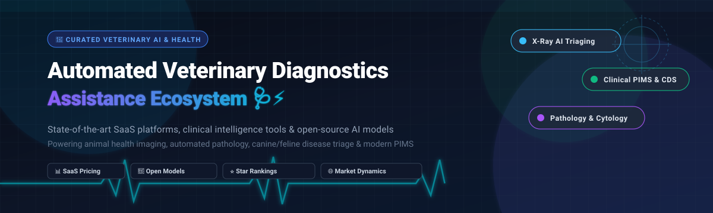
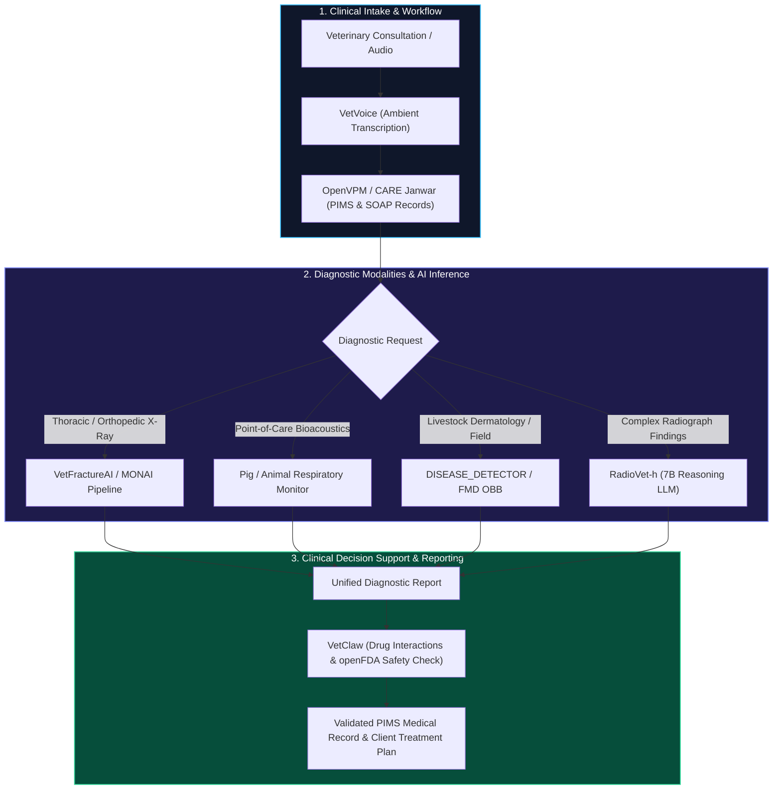

  

  
  
  
  
  
  
  

---

# 🐾 Awesome Automated Veterinary Diagnostics Assistance

> **A curated, SEO-optimized registry of SaaS platforms, clinical decision support (CDS) software, veterinary imaging AI models, automated pathology systems, and open-source machine learning repositories for companion animal and livestock healthcare.**

**Last Updated:** March 2026 | **Maintained by:** [@ishandutta2007](https://github.com/ishandutta2007)

---

## 📖 Overview & SEO Summary

Automated Veterinary Diagnostics Assistance represents the intersection of **veterinary medicine**, **computer vision**, **clinical natural language processing (NLP)**, and **point-of-care (POC) laboratory automation**. These technologies empower veterinarians, animal hospitals, emergency clinics, livestock managers, and diagnostic reference laboratories to:

- 🩻 **Accelerate Veterinary Radiology**: Automate canine, feline, and equine X-ray, ultrasound, CT, and MRI anomaly detection with deep learning.
- 🔬 **Automate Clinical Pathology & Cytology**: Streamline complete blood counts (CBC), blood smear analysis, differential leukocyte counts, and digital fecal parasite PCR triage.
- 💡 **Augment Clinical Decision Support (CDS)**: Provide evidence-based differential diagnosis recommendations, medication cross-checking, and emergency triage prioritization.
- 📋 **Automate Clinical Documentation**: Reduce veterinary burnout using real-time ambient AI scribes and automated SOAP note generation linked to Practice Information Management Systems (PIMS).

---

## 📑 Table of Contents

- [🌐 Sector Overview & Market Dynamics](#-sector-overview--market-dynamics)
- [🏢 SaaS & Hosted Platforms](#-saas--hosted-platforms)
- [💻 Open-Source GitHub Projects](#-open-source-github-projects)
- [🧠 Open-Weight Models & Research Artifacts](#-open-weight-models--research-artifacts)
- [🛠️ Architectural Blueprints & Self-Hosting](#️-architectural-blueprints--self-hosting)
- [🤝 How to Contribute](#-how-to-contribute)
- [⭐ Star History](#-star-history)
- [💖 Support & Sponsoring](#-support--sponsoring)
- [⚠️ Disclaimer](#️-disclaimer)

---

## 🌐 Sector Overview & Market Dynamics

The global **veterinary diagnostics and clinical intelligence market** is experiencing unprecedented expansion:

- **Market Sizing & Growth Runway**: The global veterinary diagnostics market is estimated at **$5.8 billion to $8.5 billion in 2024–2026**, and is projected to surpass **$15.0 billion to $21.5 billion by 2032–2034**, advancing at a Compound Annual Growth Rate (**CAGR of 8.8% to 11.0%**). Catalysts include the humanization of companion pets, higher clinical care standards, rising adoption of pet insurance, and strict biosecurity surveillance in production livestock.
- **Market Structure & Consolidation vs. Fragmentation**:
  - **Core Infrastructure Layer (Moderately Consolidated / Oligopoly)**: The market's high-volume reference laboratory testing and proprietary point-of-care (POC) analyzer hardware are dominated by a select group of multinational leaders—principally **IDEXX Laboratories**, **Zoetis**, and **Mars Petcare (Antech Diagnostics & Heska)**. These players control proprietary analyzer consumables, captive reagent rental contracts, and enterprise hospital networks.
  - **SaaS, Edge AI & Clinical Applications (Highly Dynamic & Fragmented)**: Conversely, the software, ambient AI scribe, radiology computer vision, and clinical decision support layer is highly fragmented. Emerging venture-backed startups (e.g., Scribenote, Vetspire, SignalPET, Vet-AI) and an active open-source ecosystem are challenging traditional vendor lock-in by offering API-first workflows, portable imaging models, and self-hostable veterinary PIMS.

---

## 🏢 SaaS & Hosted Platforms

The table below lists leading commercial SaaS and hosted veterinary diagnostics platforms. It is **sorted in descending order by company size (valuation or annual revenue)**.

| Platform / Product | Clinical Focus & Modality | Company Size (Revenue / Valuation) | Starting Tier Pricing | Free Tier / Trial Limits |
| :--- | :--- | :--- | :--- | :--- |
| **[Zoetis Dx](https://www.zoetis.com/)** | Point-of-care chemistry, hematology analyzers, digital cytology & AI diagnostics (Vetscan Imagyst) | **$80B+ Market Cap** *(NYSE: ZTS; ~$8.54B annual revenue)* | **$15–$25 per rotor/cartridge** *(e.g., Vetscan VS2 comprehensive rotor ~$18–$24; ~$350/mo minimum consumable commitment for hardware placement; ZoetisDx web portal access is $0)* | **30-day clinical evaluation pilot** with sample test runs arranged via sales representative; permanent free access to ZoetisDx online results platform for active device accounts. |
| **[Idexx VetLab](https://www.idexx.com/en/veterinary/)** | Reference lab diagnostics, in-house analyzers (Catalyst One, ProCyte One), and AI radiology PACS | **$38B+ Market Cap** *(NASDAQ: IDXX; ~$3.8B annual revenue)* | **$12–$22 per run/test** *(Catalyst Chem ~$12–$18/slide set, SNAP 4Dx ~$16–$22/test; $0 upfront analyzer placement under IDEXX 360 volume commitment; Web PACS starts at ~$100/mo)* | **Free forever access** to **VetConnect PLUS** cloud results portal and mobile app for active IDEXX accounts; analyzer demo evaluations with complimentary trial runs upon sales consultation. |
| **[Antech Diagnostics](https://www.antechdiagnostics.com/)** | Reference laboratory testing, digital pathology, fecal PCR (KeyScreen), and AI radiograph triage (AIS RapidRead) | **Mars Petcare Division** *(Parent $50B+ revenue; Antech division ~$1B+ annual revenue)* | **$25–$35 per routine baseline panel** *(CoreChem ~$35, CBC ~$28; AIS RapidRead AI triage ~$15–$25 per study; $0 extra charge for auto-escalated emergency radiologist STAT review)* | **Free forever portal access** via HealthTracks for test ordering, patient reporting, and trending; in-clinic analyzer/imaging demos with trial runs available upon request. |
| **[Heska](https://www.heska.com/)** | Point-of-care hematology (Element HT5), chemistry (Element DC5X), and automated urine/fecal microscopy | **$1.3B Acquisition Valuation** *(Acquired by Mars Petcare / Antech; ~$257M annual revenue)* | **$250–$350/month consumable commitment** *(Reset Program provides $0 upfront hardware capital cost with consumable agreements; ~$8–$14 per chemistry test rotor)* | **In-clinic side-by-side demonstration** with sample specimen test runs on Element analyzers upon request; all machine maintenance, repairs, and hardware upgrades included free for program duration. |
| **[PetDx](https://www.petdx.com/)** | Next-generation sequencing (NGS) liquid biopsy blood test for multi-cancer early detection (OncoK9) | **~$150M–$250M Peak Valuation** *($72M venture capital raised; operations ceased March 2024)* | **$599 per test** *(OncoK9 canine cancer screening liquid biopsy; diagnostic panel historically priced $599–$999 per sample)* | **0 free tests** *(Clinical NGS laboratory test with no free trial; company ceased accepting clinical samples in March 2024 due to funding constraints; retained for sector benchmarking)*. |
| **[Scribenote](https://www.scribenote.com/)** | Ambient veterinary AI medical scribe generating structured SOAP notes from clinical consultations | **~$35M–$45M Est. Valuation** *($8.2M Seed round led by Andreessen Horowitz / a16z)* | **$99/month per DVM** *(or $79/month billed annually at $948/year; all non-DVM support staff, RVTs, and veterinary technicians are included at $0)* | **Free forever plan** with unlimited basic note generation using standard AI models and default templates; **14-day free trial** of Scribenote Pro with full PIMS integration and custom templates (no credit card required). |
| **[Vetspire](https://www.vetspire.com/)** | Cloud-native veterinary PIMS with embedded AI clinical documentation, client messaging & CDS | **~$30M–$50M Est. Valuation** *(Acquired by Thrive Pet Healthcare network; estimated $10M–$25M ARR)* | **$349/month per full-time DVM** *(Comprehensive cloud PIMS license with integrated AI SOAP charting, automated client reminders, and inventory management)* | **14-day guided sandbox trial** and interactive demonstration environment provided to qualified veterinary practices following sales consultation. |
| **[Vet-AI](https://www.vet-ai.com/)** | Telehealth clinical triage, AI symptom analysis & differential diagnosis (Joii Pet Care app) | **~$15M–$25M Valuation** *(£12.6M+ / ~$16M funding from Hill's Pet Nutrition & Elmwood)* | **£28 (~$36) per video consultation** *(Flat fee per consult with licensed veterinarians 24/7; £0 / Free for pets insured with partner providers including Animal Friends, ASDA, Purely Pets, and Waggel)* | **Free forever AI symptom checker** covering 160+ pet conditions and free triage messaging with veterinary nurses in the Joii Pet Care app. |
| **[Vet-Anatomy](https://www.vet-anatomy.com/)** | Interactive veterinary imaging anatomy atlas & clinical radiology correlation (IMAIOS) | **~$15M–$25M Est. Valuation** *(Bootstrapped & profitable; ~$5M–$10M annual revenue)* | **$21.99/month** *(or $132.99/year for individual access; institutional multi-user plans start at $754/year for up to 10 seats)* | **Free forever access** to selected anatomical modules, sample radiograph schemas, and the IMAIOS Web DICOM Viewer; **14-day institutional trial** for accredited veterinary universities and teaching hospitals. |
| **[SignalPET](https://www.signalpet.com/)** | Instant veterinary AI radiology interpretation for canine and feline radiographs (X-rays) | **~$10M–$20M Est. Valuation** *(Bootstrapped; ~$3.5M annual revenue; 360° radiology suite)* | **$30 per study** *(SignalPET Complete AI radiology report; routine human board-certified radiologist read begins at $60/study; emergent STAT read at $100/study)* | **30-day free trial** for veterinary clinics with full AI radiology report generation (no credit card or upfront commitment required). |

---

## 💻 Open-Source GitHub Projects

Below is a curated list of active open-source repositories advancing veterinary imaging, practice management, disease detection, and clinical informatics.

Repositories are **sorted in descending order by GitHub star count**, with verified star badges linking directly to each repository's stargazers page:

### 1. 🌟 [Project-MONAI / MONAI](https://github.com/Project-MONAI/MONAI)

- **Primary Domain**: Medical & Veterinary Deep Learning Imaging Framework
- **License**: Apache-2.0 | **Tech Stack**: Python, PyTorch, CUDA
- **Description**: MONAI (Medical Open Network for AI) is the leading PyTorch-based framework for healthcare imaging. It provides specialized deep learning architectures, transformations, and evaluation metrics used globally by veterinary AI researchers to train segmentation and classification models for animal X-rays, ultrasound, CT, and MRI scans.

### 2. 🏥 [CARE Janwar (ohcnetwork / care)](https://github.com/ohcnetwork/care)

- **Primary Domain**: Open-Source Animal Healthcare Infrastructure & Public Hospital System
- **License**: MIT | **Tech Stack**: Python, Django, React, TypeScript, PostgreSQL
- **Description**: Digital Public Good adapted for veterinary hospitals, rescue clinics, and animal health programs. Features longitudinal multi-animal medical records, clinical encounters, diagnostic lab order tracking, vaccination schedules, inventory and pharmacy management, and field-worker dashboards with native AI drafting hooks.

### 3. 📊 [VetDataHub / VetDataHub](https://github.com/Vetdatahub/VetDataHub)

- **Primary Domain**: Open Veterinary Machine Learning Datasets & Benchmark Registry
- **License**: Open Data | **Tech Stack**: Python, Markdown, Data Registry
- **Description**: Community-driven repository dedicated to advancing veterinary medicine through open-access datasets. Aggregates multi-species veterinary clinical data, diagnostic radiograph archives, ultrasound records, and genomic datasets for academic and non-commercial model development.

### 4. ⚡ [OpenVPM / OpenPIMS (evangauer / openvpm)](https://github.com/evangauer/openvpm)

- **Primary Domain**: API-First Veterinary Practice Information Management System (PIMS)
- **License**: Open Source | **Tech Stack**: Go, TypeScript, React, PostgreSQL, Docker
- **Description**: Modern, self-hostable veterinary PIMS with a developer-first REST API. Includes structured SOAP records, laboratory telemetry integration, prescription drug-interaction verification, appointment scheduling, and native webhooks for connecting ambient AI scribes and diagnostic agent bots.

### 5. 🤖 [VetClaw (OpenVet-Projects / VetClaw)](https://github.com/OpenVet-Projects/VetClaw)

- **Primary Domain**: Species-Aware Veterinary AI Skill Library & Agentic CDS
- **License**: Apache-2.0 | **Tech Stack**: Python, LangChain, openFDA
- **Description**: The first dedicated veterinary AI skill library for OpenClaw. Offers 51+ species-aware, safety-first clinical skills and openFDA reference clients for automated drug safety screening, diagnostic workup suggestions, and pharmaceutical dosages across companion animals and livestock.

### 6. 🏷️ [VetTag (yuhui-zh15 / VetTag)](https://github.com/yuhui-zh15/VetTag)

- **Primary Domain**: Automated Veterinary Diagnostic Coding via Large Language Models
- **License**: Academic Research | **Tech Stack**: Python, PyTorch, Hugging Face Transformers
- **Description**: Official open-source codebase for automated diagnostic code extraction from unstructured veterinary clinical notes. Leverages hierarchical medical language models to map free-text clinical narratives to standardized veterinary diagnostic taxonomies (VeNom and SNOMED-CT).

### 7. 🐾 [Ababu (oldauntie / ababu)](https://github.com/oldauntie/ababu)

- **Primary Domain**: Problem-Oriented Multi-Platform Veterinary Practice Management
- **License**: GPL-3.0 | **Tech Stack**: Python, wxPython, SQLite
- **Description**: Problem-oriented veterinary software designed to record clinical consultations, diagnostic exams, vaccinations, and surgical procedures with zero vendor lock-in.

### 8. 🖼️ [Veterinary Image Datasets (kvinicki / Veterinary-image-datasets)](https://github.com/kvinicki/Veterinary-image-datasets)

- **Primary Domain**: Benchmark Index of Veterinary Medical Imaging Datasets
- **License**: Public Research | **Tech Stack**: Markdown, Dataset Index
- **Description**: Comprehensive directory indexing public veterinary radiology, histopathology, and ultrasound datasets for training and benchmarking computer vision models on animal anatomy.

### 9. 🎙️ [VetVoice (georgewangchn / VetVoice)](https://github.com/georgewangchn/VetVoice)

- **Primary Domain**: Veterinary Speech-to-Text & AI SOAP Note Generator
- **License**: Open Source | **Tech Stack**: Python, Vue, Whisper AI, Electron
- **Description**: Smart electronic medical record assistant plugin that transcribes doctor-patient dialogues during veterinary appointments into structured clinical records, cutting administrative charting time.

### 10. 🦠 [Disease Predictor (abhi-abhi86 / disease-predictor)](https://github.com/abhi-abhi86/disease-predictor)

- **Primary Domain**: Multi-Species Animal Disease Prediction & Computer Vision
- **License**: MIT | **Tech Stack**: Python, TensorFlow, OpenCV, Streamlit
- **Description**: Deep learning system capable of offline disease detection and symptom prediction across companion animals and livestock without requiring cloud API keys.

### 11. 🐐 [Goat Disease Prediction using AIOT (Biancaa-R / Goat-disease-prediction-using-AIOT-)](https://github.com/Biancaa-R/Goat-disease-prediction-using-AIOT-)

- **Primary Domain**: Edge IoT + AI Livestock Disease Surveillance
- **License**: MIT | **Tech Stack**: Python, ONNX, YOLO, Raspberry Pi, MQTT
- **Description**: Edge IoT surveillance architecture utilizing wearable sensors and Raspberry Pi-hosted ONNX YOLO models to identify Peste des Petits Ruminants (PPR/Scabby Mouth), Tetanus, and Goat Pox in real time.

### 12. 🐄 [DISEASE_DETECTOR (im-Amrith / DISEASE_DETECTOR)](https://github.com/im-Amrith/DISEASE_DETECTOR)

- **Primary Domain**: Mobile Livestock Skin Condition Diagnostics
- **License**: Open Source | **Tech Stack**: Python, MobileNetV2, Flask, HTML5
- **Description**: Lightweight diagnostic web application detecting 7 common livestock skin conditions (including Bovine Respiratory Disease, Contagious Ecthyma, and Lumpy Skin Disease) with instant confidence score readouts.

### 13. 🦴 [VetFractureAI (alvendherfrancisco / vet-fracture-ai)](https://github.com/alvendherfrancisco/vet-fracture-ai)

- **Primary Domain**: Femoral Fracture Detection & AO/OTA Severity Classification
- **License**: Apache-2.0 | **Tech Stack**: Python, Faster R-CNN (ResNet-50 + FPN V2), FastAPI
- **Description**: Deep learning system trained on 1,264 canine and feline radiographs to detect femoral shaft fractures and classify them according to AO/OTA fracture standards. Delivers **88.36% mAP@0.5** and **97.83% specificity**.

### 14. 🐂 [FMD AI Diagnosis System (Ahmet-zmn / FMD)](https://github.com/Ahmet-zmn/FMD)

- **Primary Domain**: Real-Time Foot and Mouth Disease Detection
- **License**: Open Access / Research | **Tech Stack**: Python, YOLO11, YOLO26 OBB, PyTorch, ONNX
- **Description**: Oriented Bounding Box (OBB) computer vision model trained to identify 6 classes of Foot and Mouth Disease lesions (mouth saliva, mouth sores, nail sores, healthy mouth, healthy nails) on cattle.

### 15. 🐖 [Pig Respiratory Monitor (Willy-chen / pig-respiratory-monitor)](https://github.com/Willy-chen/pig-respiratory-monitor)

- **Primary Domain**: Bioacoustic Piglet Respiratory Distress Detection
- **License**: Open Research | **Tech Stack**: Python, Audio Spectrogram Transformer (AST), XGBoost
- **Description**: Acoustic monitoring toolkit using electronic stethoscope recordings and AST embeddings to detect respiratory disease in commercial barn environments with a macro F1 score of 0.8592.

---

## 🧠 Open-Weight Models & Research Artifacts

For practitioners and developers deploying self-hosted inference pipelines, the following specialized models and weights are publicly available:

- 🩻 **[RadioVet-h (viggoVet)](https://huggingface.co/viggovet/RadioVet-h)** *(Hugging Face)*:
  - 7B parameter open-weight veterinary radiology language model with **ISO/IEC 42001:2023 certification**. Employs a hybrid Sequential-Transformer architecture achieving up to 70% memory reduction compared to generalist models while performing clinical assessment and differential diagnosis from radiograph findings. *(Non-commercial CC BY-NC-SA 4.0)*.
- 🐱 **[abirmed_animal_slm](https://huggingface.co/abirmaheshwari/abirmed_animal_slm)** *(Hugging Face)*:
  - Lightweight 38M-parameter Small Language Model (SLM) trained from scratch on curated veterinary educational texts. Optimized for CPU-only inference on low-power clinic workstations for veterinary educational assistance. *(MIT License)*.
- 🫁 **[Canine Pneumothorax Detection](https://github.com/Pu-Wang-alt/Canine-pneumothorax)** *(Research & Code / arXiv 2604.05482)*:
  - Unifies Vision-Language Model (VLM)-guided Flow Matching with Random Matrix Theory (RMT) to detect and segment canine pneumothorax lesions in thoracic radiographs.
- 🔬 **[SEPO-WBC Canine Blood Smear Classifier](https://doi.org/10.1016/j.compbiomed.2024.108422)**:
  - Two-stage architecture pairing YOLOv8 (mAP@50 0.935) with DenseNet-201 (accuracy 0.878) for automated white blood cell detection and differential count classification in dogs.

---

## 🛠️ Architectural Blueprints & Self-Hosting

Practices seeking an independent, vendor-agnostic on-premise diagnostics suite can compose a complete solution using open-source modules:

---

## 🤝 How to Contribute

Contributions from veterinary clinicians, radiologists, bioinformaticians, and software engineers are enthusiastically welcomed!

1. 🍴 **Fork the Repository** on GitHub.
2. 🌿 **Create a Feature Branch**: `git checkout -b feature/add-new-veterinary-tool`.
3. 📝 **Update `README.md`**: Follow the established table formatting for SaaS platforms (with explicit pricing and free trial limits) or open-source entries (including social star badge linked to stargazers).
4. ✅ **Ensure Standards**: Verify factual descriptions, valid HTTPS links, and avoid unsubstantiated marketing claims.
5. 🚀 **Submit a Pull Request** with a clear explanation of the clinical utility.

---

## ⭐ Star History

---

## 💖 Support & Sponsoring

Thank you for visiting and supporting **Awesome Automated Veterinary Diagnostics Assistance**! 🐾

If this curated registry, comparative pricing breakdown, or open-source index has supported your clinical practice, veterinary research, or animal-health development, please consider showing your support:

- ⭐ **Star this repository** to improve discoverability across the veterinary software community.
- 🍴 **Fork & Share** with colleagues, academic clinics, and open-source health developers.
- ☕ **Sponsor or Buy a Coffee**: Help fund maintenance, dataset indexing, and continuous verification via the **[GitHub Sponsors Dashboard](https://github.com/sponsors/ishandutta2007)**.

---

## ⚠️ Disclaimer

- 🩺 **Clinical Decision Support Aid Only**: The AI models, open-source software, and SaaS tools cataloged in this repository are intended as clinical decision support aids. They **do not replace the professional judgment, examination, and diagnosis of a licensed veterinary practitioner**.
- 🔬 **Research & Validation**: Many open-source models are academic prototypes trained on localized datasets. Always perform rigorous internal validation on local clinical data and equipment before production deployment.
- 🔒 **Data Privacy & Compliance**: Veterinary medical records are subject to client confidentiality and data protection regulations (such as GDPR, CCPA, and veterinary practice acts depending on jurisdiction). Ensure proper HIPAA/GDPR equivalent safeguards when handling client and patient data.

---

  <b>Built with care for veterinarians, animal-health researchers, and engineers building the future of veterinary medicine. 🐕🐈🐎🐄</b>

